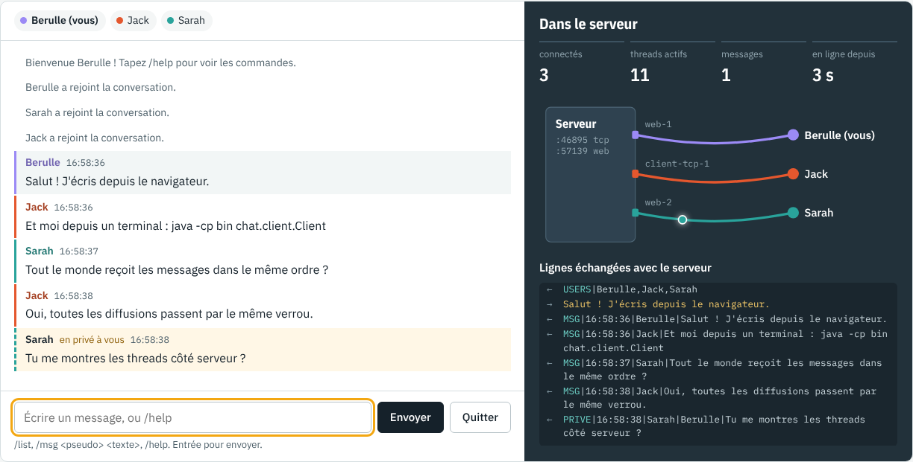
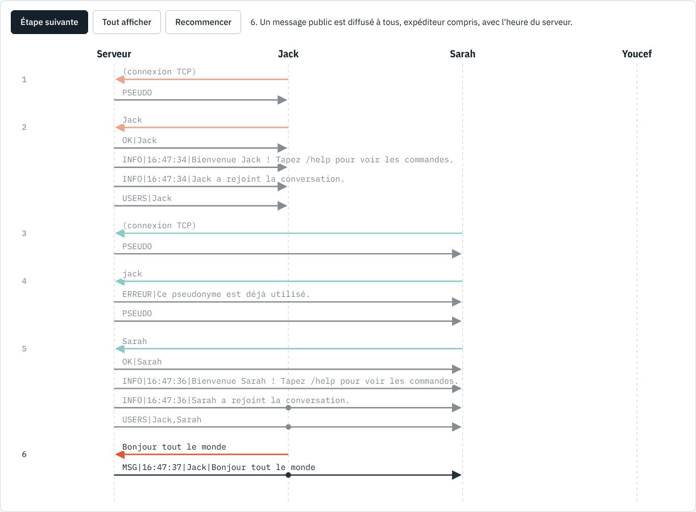

# Multithreaded Chat

[](https://github.com/berullekkb/multithreaded-chat/actions/workflows/pages.yml)

**Site interactif : [berullekkb.github.io/multithreaded-chat](https://berullekkb.github.io/multithreaded-chat/)**
(démo du salon avec serveur simulé, protocole rejoué pas à pas, architecture des threads).

<table>
  <tr>
    <td colspan="2"><a href="https://berullekkb.github.io/multithreaded-chat/#salon"></a></td>
  </tr>
  <tr>
    <td colspan="2"><b>Salon</b> : deux navigateurs et un terminal dans le même salon. À droite, chaque client est un câble branché au serveur, avec le nom du thread qui le sert (<code>client-tcp-1</code>, <code>web-2</code>…) ; chaque message part de l'expéditeur, passe par le serveur et repart vers tout le monde. En dessous, les lignes brutes du protocole.</td>
  </tr>
  <tr>
    <td width="55%"><a href="https://berullekkb.github.io/multithreaded-chat/#protocole"></a></td>
    <td><b>Protocole rejoué</b> : une session enregistrée sur le vrai serveur Java (3 clients, 11 étapes) déroulée flèche par flèche : pseudo refusé, diffusion, message privé, historique, départ.</td>
  </tr>
</table>

Application de chat multi-clients en Java, construite avec des **sockets TCP** et des **threads**,
sans aucune bibliothèque externe. Plusieurs utilisateurs se connectent en même temps, choisissent un
pseudonyme unique et discutent en temps réel, depuis un **terminal** ou depuis un **navigateur** :
tout le monde est dans le même salon.

- **Serveur** : un thread par client, réservation atomique des pseudos, diffusion ordonnée sous un
  verrou unique, historique des 20 derniers messages, messages privés, arrêt propre.
- **Interface web** servie par le serveur lui-même (`com.sun.net.httpserver` + Server-Sent Events),
  qui montre en direct les threads et les lignes du protocole.
- **Client console** à deux threads (réception / envoi).
- **Démo en ligne** sur GitHub Pages : le serveur y est simulé en JavaScript, et un test vérifie qu'il
  produit exactement les mêmes lignes que le serveur Java.

---

## Démarrage rapide

Prérequis : un **JDK 11 ou plus récent** (`java -version` et `javac -version`).

### Windows

Double-cliquer sur **`LANCER_SERVEUR.bat`** : il compile, démarre le serveur et ouvre
[http://localhost:8080](http://localhost:8080). Pour un client console, double-cliquer sur
**`LANCER_CLIENT.bat`** (autant de fois que voulu).

En ligne de commande (PowerShell, depuis la racine du projet) :

```powershell
javac -encoding UTF-8 -d bin (Get-ChildItem -Recurse src -Filter *.java).FullName
java -cp bin chat.server.Serveur          # serveur : TCP 5000 + web 8080
java -cp bin chat.client.Client           # client console (localhost 5000)
```

### Linux / macOS

```bash
./lancer.sh                  # compile et démarre le serveur
./lancer.sh client           # client console
```

### Options

```text
java -cp bin chat.server.Serveur [--port 5000] [--web 8080] [--docs docs] [--max 50] [--sans-web]
java -cp bin chat.client.Client [hôte] [port]
```

Au démarrage, le serveur affiche aussi son adresse sur le réseau local
(par exemple `http://192.168.1.20:8080`) : les autres machines du réseau peuvent ouvrir l'interface
web ou lancer `java -cp bin chat.client.Client 192.168.1.20 5000`.

> Le serveur doit être lancé depuis la racine du projet pour trouver le dossier `docs/`
> (sinon, préciser `--docs chemin/vers/docs`). Si le port 8080 est déjà pris, l'interface web est
> désactivée avec un message et le chat TCP fonctionne quand même : relancer avec `--web 8081`.

---

## Utilisation

| Saisie | Effet |
|---|---|
| `Bonjour` | message public, diffusé à tous (expéditeur compris) |
| `/msg Sarah Tu as fini ?` | message privé, reçu seulement par Sarah et par l'expéditeur |
| `/list` | liste des connectés |
| `/help` | liste des commandes |
| `/quit` ou `exit` | quitter le salon |

Exemple côté console :

```text
Connexion au serveur localhost:5000 réussie.
Entrez votre pseudo : Jack
Pseudo accepté. Vous pouvez discuter.
Tapez /help pour les commandes, exit pour quitter.
[14:02:11] * Bienvenue Jack ! Tapez /help pour voir les commandes.
[14:02:11] * Jack a rejoint la conversation.
[14:02:30] * Sarah a rejoint la conversation.
[14:02:41] Sarah : Salut Jack
[14:03:40] (privé) Sarah -> Jack : Tu as fini le TD ?
```

---

## Architecture

```text
                                  Serveur (main : accept)
                                            |
        +-----------------------------------+--------------------------------+
        |                                   |                                |
  ClientHandler                      ClientHandler                    PasserelleWeb (HTTP)
  thread client-tcp-1                thread client-tcp-2               threads web-N (1 par flux SSE)
        |                                   |                                |
        +-------------------------> SalonDeChat <----------------------------+
                         participants (ConcurrentHashMap)
                         verrou de diffusion + historique
```

Le salon ne manipule que des `Participant` : un client TCP (`ClientHandler`) et un navigateur
(`ParticipantWeb`) sont traités exactement de la même façon.

### Rôle des classes

| Classe | Rôle |
|---|---|
| `chat.protocole.Protocole` | format des lignes, validation des pseudos, nettoyage des messages ; partagé par serveur et client |
| `chat.server.Serveur` | point d'entrée : options, `ServerSocket`, pool de threads borné, arrêt propre (Ctrl+C) |
| `chat.server.SalonDeChat` | état partagé : réservation des pseudos, diffusion, historique, commandes |
| `chat.server.Participant` | ce que le salon sait d'un utilisateur (pseudo, type, thread, compteurs) |
| `chat.server.ClientHandler` | un client TCP, dans son propre thread : pseudo puis boucle de lecture |
| `chat.server.web.PasserelleWeb` | sert `docs/` et l'API web : `/api/join`, `/api/flux` (SSE), `/api/send`, `/api/leave`, `/api/status` |
| `chat.server.web.ParticipantWeb` | un navigateur : une file de lignes vidée par le thread de son flux SSE |
| `chat.client.Client` | client console : connexion, choix du pseudo, lancement des deux threads |
| `chat.client.MessageReceiver` | thread qui affiche les messages reçus |
| `chat.client.MessageSender` | thread qui lit le clavier et envoie les lignes |

### Concurrence : ce qui est garanti (et testé)

- **Pseudo unique, même en course** : `ConcurrentHashMap.putIfAbsent`, insensible à la casse.
  20 clients qui demandent le même pseudo au même instant : un seul l'obtient.
- **Même ordre pour tout le monde** : toutes les diffusions passent par un verrou unique.
  30 clients qui écrivent au même instant reçoivent les 30 messages dans le même ordre.
- **Pas de message perdu à l'arrivée** : envoi de l'historique et activation du nouvel arrivant se
  font sous ce même verrou.
- **Nettoyage garanti** : `exit`, terminal fermé ou réseau coupé, le bloc `finally` libère le
  pseudo et prévient les autres, une seule fois (départ idempotent).
- **Pool borné** : au-delà de `--max` clients, la connexion reçoit `ERREUR|Serveur complet…` puis `BYE`.
- **UTF-8 explicite** sur les sockets : les accents passent entre Windows (cp1252 par défaut) et Linux.
- **Écritures synchronisées** : plusieurs threads peuvent écrire sur le même socket sans mélanger les lignes.

---

## Protocole

Une ligne de texte UTF-8 par message. Le premier champ donne le type ; le texte libre est toujours le
dernier champ, il peut donc contenir des `|`.

| Serveur → client | Signification |
|---|---|
| `PSEUDO` | le serveur attend un pseudonyme |
| `OK\|Jack` | pseudonyme accepté |
| `ERREUR\|Ce pseudonyme est déjà utilisé.` | pseudo refusé, commande inconnue, destinataire introuvable |
| `MSG\|14:02:11\|Jack\|Bonjour` | message public |
| `HISTO\|14:02:11\|Jack\|Bonjour` | message public envoyé avant l'arrivée du client (20 au plus) |
| `PRIVE\|14:03:40\|Sarah\|Jack\|Tu as fini ?` | message privé |
| `INFO\|14:03:58\|Youcef a rejoint la conversation.` | arrivées, départs, réponses à `/list` et `/help` |
| `USERS\|Jack,Sarah,Youcef` | liste des connectés, à chaque arrivée ou départ |
| `BYE` | le serveur ferme la connexion |

Connexion type :

```text
Serveur -> PSEUDO
Client  -> jack
Serveur -> ERREUR|Ce pseudonyme est déjà utilisé.
Serveur -> PSEUDO
Client  -> Sarah
Serveur -> OK|Sarah
Serveur -> HISTO|14:02:11|Jack|Bonjour tout le monde
Serveur -> INFO|14:02:30|Bienvenue Sarah ! Tapez /help pour voir les commandes.
Serveur -> INFO|14:02:30|Sarah a rejoint la conversation.     (à tout le monde)
Serveur -> USERS|Jack,Sarah                                   (à tout le monde)
```

Les navigateurs reçoivent exactement les mêmes lignes, une par événement SSE.

---

## Tests

```bash
pip install pytest
python -m pytest            # 33 tests : lancent le vrai serveur Java et lui parlent en TCP et HTTP
node tests/js/parite.test.mjs   # le serveur simulé de la démo == le serveur Java
```

- `tests/test_serveur.py` : pseudos (doublon, casse, invalides, accents), diffusion UTF-8, historique,
  `/list`, `/help`, `/msg`, départ volontaire et brutal, 30 clients simultanés, réservation atomique,
  serveur complet, arrêt du serveur, passerelle web (TCP ↔ navigateur, SSE, sécurité des chemins).
- `tests/test_trace.py` : la session rejouée sur le site (`docs/data/trace.json`) correspond au
  serveur Java actuel. Pour la régénérer : `python scripts/enregistrer_trace.py`.
- `tests/js/parite.test.mjs` : le simulateur JavaScript rejoue cette trace ligne pour ligne.
- `tests/test_site.py` : fichiers, liens et identifiants du site.

GitHub Actions lance tout à chaque push, puis publie `docs/` sur GitHub Pages.
Les captures du README se régénèrent avec `python scripts/capture_site.py` (Playwright).

---

## Structure du projet

```text
multithreaded-chat/
├── src/main/java/chat/
│   ├── protocole/Protocole.java
│   ├── server/
│   │   ├── Serveur.java
│   │   ├── SalonDeChat.java
│   │   ├── Participant.java
│   │   ├── ClientHandler.java
│   │   └── web/
│   │       ├── PasserelleWeb.java
│   │       └── ParticipantWeb.java
│   └── client/
│       ├── Client.java
│       ├── MessageReceiver.java
│       └── MessageSender.java
├── docs/                      interface web (servie par le serveur ET publiée sur GitHub Pages)
│   ├── index.html
│   ├── assets/                app.js, protocole.js, simulateur.js, robots.js, style.css, polices/
│   ├── data/trace.json        session réelle enregistrée sur le serveur Java
│   └── images/                captures du README
├── tests/                     pytest (intégration) + tests/js (parité)
├── scripts/                   enregistrer_trace.py, capture_site.py
├── .github/workflows/pages.yml
├── COMPILER.bat  LANCER_SERVEUR.bat  LANCER_CLIENT.bat  PUBLIER.bat
└── lancer.sh
```

---

## Choix techniques et limites

- **TCP** pour une connexion fiable et ordonnée ; **lectures bloquantes** (`readLine()`), ce qui est
  sans danger puisque chaque client a son thread.
- **1 client = 1 thread** : simple à comprendre et suffisant pour quelques centaines de clients.
  Pour des milliers de connexions, Java NIO (ou les threads virtuels de Java 21) serait plus adapté.
- **SSE plutôt que WebSocket** côté web : le flux serveur → navigateur suffit (l'envoi passe par un
  POST) et s'implémente avec la seule bibliothèque standard.
- Un client TCP qui ne lit plus du tout peut, une fois son tampon réseau plein, ralentir les
  diffusions (elles se font sous le verrou). Une file d'envoi par client lèverait cette limite.
- Pas de chiffrement (TLS), d'authentification ni de persistance de l'historique : projet pédagogique
  centré sur les sockets et la concurrence.

---

## Auteur

**Berulle KAMDEM KAMDEM**

Email : [berullekkb@gmail.com](mailto:berullekkb@gmail.com)

Projet Java consacré à la programmation réseau, aux sockets TCP et au multithreading.
Pour toute question ou suggestion, ouvrez une Issue sur le dépôt ou contactez l'auteur par email.
